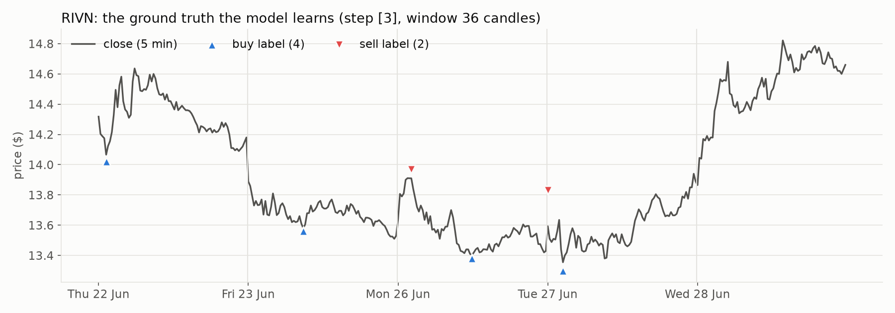
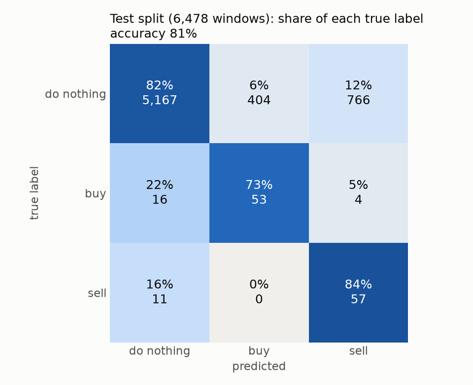
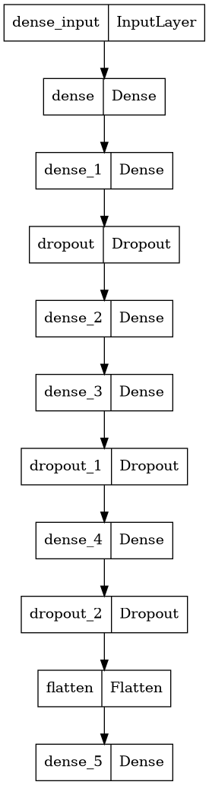
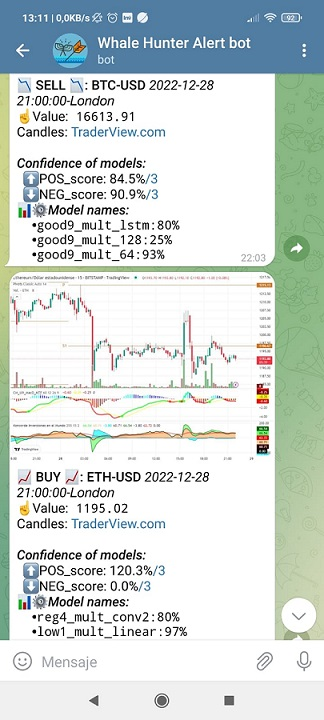

# TensorFlow stock prediction: buy / sell points on 5-minute candles

A tutorial pipeline that learns **where to buy, where to sell and where to do nothing** on
5-minute stock candles. It computes ~290 technical indicators, keeps the ~40 most related to the
target, and trains a TensorFlow network on 4-hour windows of them.

<p align="center">
  
</p>

<table>
<tr>
<td width="62%"></td>
<td width="38%" align="center"></td>
</tr>
<tr>
<td><sub>What <code>pipeline/1_train.py</code> scores on the RIVN sample. Most real buy and sell points are found,
but only 12% of predicted buys and 7% of predicted sells are right: the model raises many false signals.</sub></td>
<td><sub>The network it trains (step [9]).</sub></td>
</tr>
</table>

## Quick start

Python 3.9–3.11 (the code is written for TensorFlow 2.15). Details and the two packages that
changed since the code was written: [docs/installation.md](docs/installation.md).

```bash
pip install -r requirements.txt
pip install -e .                  # makes stockpred/ importable
python pipeline/1_train.py        # trains on data/sample/ and prints the evaluation (a few minutes on a CPU)
python tools/make_readme_figures.py   # redraws the three figures above from that run
```

The scripts work from any folder: every path is anchored at the repository root
(`stockpred/paths.py`), and everything they write goes to `outputs/`, which git ignores.

## The pipeline

| Step | Script | What it does | Writes |
|---|---|---|---|
| 0 | `pipeline/0_download_alpaca.py`, `0_download_alphavantage.py` | Download 5-min price history (keys from `ALPACA_API_KEY`/`ALPACA_API_SECRET`, `ALPHAVANTAGE_API_KEYS`) | `data/alpaca/`, `data/RAW_alpha/` |
| 1 | `pipeline/1_train.py` | The tutorial: the 11 steps below, for one stock | `outputs/models/`, `scalers/`, `columns_select/`, `plots/` |
| 2 | `pipeline/2_tune.py` | Trains five hand-picked network sizes per stock | `outputs/models/`, `val_data/`, `model_info/`, `logs/` |
| 3 | `pipeline/3_evaluate.py` | Scores the step-2 models on held-out windows, marks the best per stock | `outputs/ALL_F1_score_EVAL_*.csv` |
| 4 | `pipeline/4_win_loss.py` | Dollars won or lost by real-time predictions, checked against Yahoo prices | (prints) |

`pipeline/1_train.py`, step by step (the `#TIP` comments in the file carry the author's experience):

1. Read the 5-min OHLCV candles
2. Compute ~290 technical indicators (`stockpred.indicators.extract_features_v3`)
3. Label each candle: buy at local lows, sell at local highs, do nothing otherwise (`stockpred/ml/buy_sell_point.py`)
4. Drop near-duplicate indicators and keep the ~40 most related to the label
5. Scale to 0–1, fitting on the training part only
6. Build 48-candle windows (4 hours) for each label
7. Split by time: the first 80% trains, the last 20% tests
8. Weight the classes: buy and sell are ~1% of candles
9. Build the network
10. Train with early stopping
11. Evaluate on the test split

The background (indicators, the "whale" problem, how the labels are chosen) is in
[docs/tutorial.md](docs/tutorial.md); ideas for improving each step are in
[docs/improvements.md](docs/improvements.md).

## Layout

```
pipeline/     the numbered scripts above, run in order
stockpred/    the library they use
  config.py     settings (windows, split ratio, feature count)      tickers.py   stock lists by key
  paths.py      where data is read and outputs are written           gpu.py, plots.py
  indicators/   the technical indicators and feature selection (was features_W3_old/)
  ml/           labels, windows, scaling, splits, evaluation (was utilW3/)
data/sample/  RIVN 5-min candles, Nov 2021 – Jul 2023 (other downloads in data/ are not committed)
outputs/      everything the pipeline writes (not committed)
docs/         tutorial, improvements, installation, images
tools/        check_imports.py (runs in CI, needs no packages), make_readme_figures.py
legacy/       the old real-time system and side experiments, frozen
```

## Known issues

Kept as found, so results stay comparable with earlier runs:

- `pipeline/2_tune.py` passes the L2 value as the learning rate, and logs a fixed 0.23 as the
  HParams score, so the TensorBoard comparison is meaningless.
- `pipeline/4_win_loss.py` computes the dollars of a long trade for sell predictions too.
- Step [4] chooses indicators using the whole history, test period included.
- `tensorflow_addons` (used by step 2) is end-of-life and ties the project to TensorFlow 2.15.

## The old real-time system

Before the tutorial, this project ran live: during market hours it scored new candles with 36 models
per stock and sent alerts to Telegram and Twitter. That system is in
[`legacy/realtime_v1/`](legacy/realtime_v1/README.md), moved as one block so it still runs
from its folder; the rest of the old code is described in [`legacy/`](legacy/README.md).

<p align="center">
  
</p>

The TradingView strategies sold on tuisku.eu were produced by a separate scikit-learn project,
not by this repository.

## Author

Luis Leciñana, [LinkedIn](https://www.linkedin.com/in/luislcastillo/). Telegram group for
collaborators: https://t.me/+3oG6U_hp93I2M2Ix

This project is a long piece of work given away free on **one condition**: if you make a major
improvement, let me know publicly or privately (leciluis@gmail.com); it will not be made public
if you do not want it. Any other contact, through the Issues tab.

**Use the software at your own risk. The authors and all affiliates assume no responsibility
for your trading results.**

[](https://www.buymeacoffee.com/leci37)
