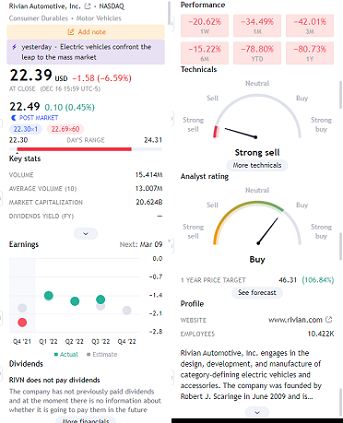
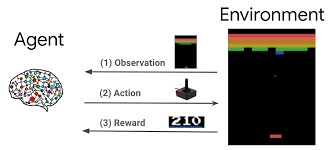
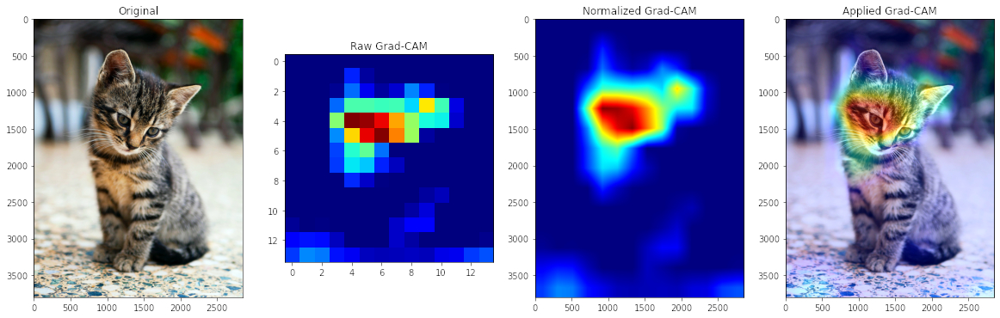
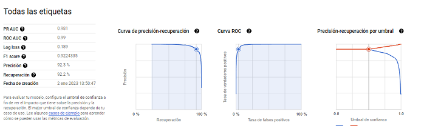
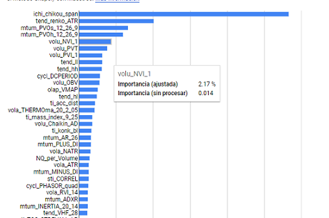
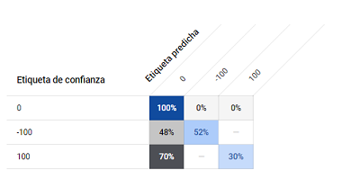
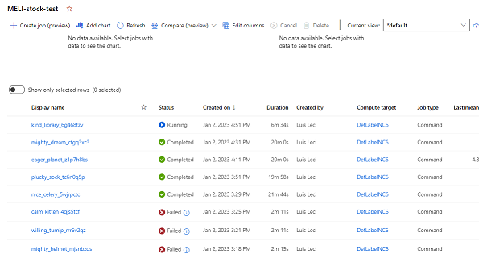

# Possible improvements

Ideas collected while building the project (moved here from the old README). Paths to the old
real-time pipeline now point into `legacy/`.
##### Combine the power of the 17 models
would be to combine the power of the 17 models tested at  https://github.com/huseinzol05/Stock-Prediction-Models predictive models with https://github.com/Leci37/stocks-Machine-learning-RealTime-telegram/tree/develop real-time pattern calculation and alerting capabilities.
Should be implemented in the method `train_model_with_custom_columns(name_model, columns_list, csv_file_SCALA, op_buy_sell : a_manage_stocks_dict.Op_buy_sell):`
For multidimension branch: `get_dicts_models_multi_dimension(self). `

another interesting improvement is the addition of PYTORCH, is the tensor flow "competence". 

##### Better use tuners
Even if the testing of the 17 models improves the result , the ML libraries, offer **_"tuners"_**, tools that test all desired combinations and turn the ideal configuration for that data. For tensor flow, see https://www.tensorflow.org/tutorials/keras/keras_tuner 
In the project there are several intents of use: `Model_finetune_TF.py`, `Model_finetune_TF_2.py` and `Model_finetune_XGB.py` (now in `legacy/research/model_finetune/`). 
Running the "tuners" code is very heavy on the computer. 
You can add more models (the 17 for example) and tune them with keras_tuner.
Example of the multiple values that keras_tuner allows: 
``` python
neurons = [2, 4,8,16,24,28,32,32,44,52,64,92,92]]
weight_constraint = [1.0, 3.0, 4.0, 5.0, 7.0]
dropout_rate = [0.0, 0.1, 0.2, 0.2, 0.3, 0.4, 0.5, 0.6, 0.7, 0.8, 0.9]
hp_learning_rate = hp.Choice('learning_rate', values=[1e-2, 1e-3, 1e-4, 1e-5])
param_grid = dict(model__dropout_rate=dropout_rate, model__weight_constraint=weight_constraint, model__neurons=neurons).
model = KerasClassifier(model=create_model_2, epochs=100, batch_size=10, verbose=2)
```
More information:
https://www.simplilearn.com/tutorials/deep-learning-tutorial/keras-tuner and 
https://machinelearningmastery.com/grid-search-hyperparameters-deep-learning-models-python-keras/

##### Real-time alert with .png financial data

You can add to the alerts the summary of the financial information from TraderView.com, this image will always be loaded with the financial-analyst information in real time.  
Image is generated by code `__create_find_data_png_trader_view(path_png + "_TRAVIEW_finan.png")`

Example of summary:




##### Improvements in predictive models using multi-dimensional 
**Solved**  _Note 29-December 2022_  in _stocks-prediction-multi_ branch (ask for it without any problem).
Improvements in TF predictive models using tensors (multiple matrices over time) and non-matrices (mono temporal, current design). 

In the class `Model_TF_definitions.ModelDefinition.py` (now in `legacy/realtime_v1/`)

Through it, the model configurations, density, number of neurons, etc. are obtained.

There are two methods:

- `get_dicts_models_One_dimension()` is currently used and generates TF model configurations for arrays. 
- `get_dicts_models_multi_dimension()` is not in use, it is set to give multiple model configurations using tensors. 

There is the `Utils.Utils_model_predict.df_to_df_multidimension_array(dataframe, BACHT_SIZE_LOOKBACK)` method, which transforms 2-dimensional df [columns , rows] to 3-dimensional df [columns , files, BACHT_SIZE_LOOKBACK ].

BACHT_SIZE_LOOKBACK means how many records in the past tense are added to the df, the number is configurable and default value is eight.

To start the development must be to call the method with BACHT_SIZE_LOOKBACK with an integer value, the method will return a multidimensional df [columns, files, BACHT_SIZE_LOOKBACK ], with which to feed the TF models.

Utils_model_predict.scaler_split_TF_onbalance(df, label_name=Y_TARGET, BACHT_SIZE_LOOKBACK=8)


**Improvement**: Once these multidimensional arrays are returned, models are obtained with `get_dicts_models_multi_dimension()`, it is not possible to train a model and make a prediction with multidimensional arrays. 

##### Review the way ground true is obtained 
It is recommended to review the point "Ground True is the variable" of the documentation, to understand this point.

Before training the models the intervals (of 15min) are classified as buy point 100 or 101, sell point -100 or .-101 or no trade point 0, these values are entered in the column Y_TARGET = **'buy_sell_point'** through the method `Utils.Utils_buy_sell_points.get_buy_sell_points_Roll()`.  

The variation is calculated with respect to the following 12 windows (15min \* 12 = 3 hours), and from there the 8% points of greatest rise and greatest fall are obtained, and these points are assigned values other than 0.

To obtain the Y_TARGET there are 2 methods that are responsible for the strategy to follow once you buy and sell, in case of loss will opt for Stop Loss.

`rolling_get_sell_price_POS()` and `rolling_get_sell_price_NEG()`

**Optional improvement**: the current system decides by percentages, i.e. the 16% highest rises and falls (8% each) are ground true. I.e. there are rises or falls greater than 3% that can be left out if the stock is very volatile.

##### For unbalanced classes, you should look at the F1-score
For unbalanced classes, you should look at the f1-score indicator https://datascience.stackexchange.com/questions/105089/how-f1-score-is-good-with-unbalanced-dataset  
What we are trying to achieve with the F1-score metric is to find an equal balance between precision and recall, which is extremely useful in most scenarios when we are working with imbalanced datasets (i.e., a dataset with a non-uniform distribution of class labels). 
A model with high recall but low precision score returns many positive results, but most of its predicted labels are incorrect when compared to the ground truth.
On the other hand, a model with high precision but low recall score returns very few results, but most of its predicted labels are correct when compared to the ground-truth. 
An ideal scenario would be a model with high precision and high recall, meaning it will return many results, with all results labelled correctly. Unfortunately, in most cases, precision and recall are often in tension. 

#####  Review the free code winners of KAGGLE 
Review the free code of people who have been in the top10 winners of kaggle, the championship models teach a lot.
At the moment I'm inspired by the 3rd place of the "price of the house in paris", it's data from .csv and unbalanced https://www.kaggle.com/code/viktortaran/ps-s-3-e-6?scriptVersionId=119565159&cellId=129  
( it's hard to find them most of the winners in kaggle don't publish in open) 
For more CHAMPIONSHIP notebooks:
https://ndres.me/kaggle-past-solutions/  
https://www.kaggle.com/code/sudalairajkumar/winning-solutions-of-kaggle-competitions 

##### Are 3 GrounsTrue detection tags sufficient or are subclasses required? 
How do you know that GrounsTrue **clustering** (_buy, sell, nothing_) is similar and correct? Is it necessary to cluster with **more labels** (_buy_A, sell_A , nothing_A, buy_B, sell_B , nothing_B, buy_C, sell_C_)? How do I know the number of tags needed ?
To solve this question you can use the "K-means Clustering" https://neptune.ai/blog/clustering-algorithms


##### Remove columns that have more than 0.9 correlation between them
Remove columns that have more than 0.9 correlation between them, as they **are redundant**. Inside the method 
```python 
uncorrelate_selection(features_X_ALL, num_features=NUMS_FEATURES, split_ratio=SPLIT_RATIO_X_Y, column_path=f'data/columns_select/{symbol}_{REF_MODEL}.pkl')
    # Look for the next line and try the correction 
    # Get the correlation table
    corr = train_data.corr()
```
More info help: https://machinelearningmastery.com/basic-data-cleaning-for-machine-learning/ 


##### Architecture to Reinforcement Learning
Another way to get a rebuild of the GT, is to change the architecture to Reinforcement Learning RL, which has the feature of not using GT, **it learns after many trial and error attempts**.
There are three types of trades buy, sell or hold. the RL randomly tests them, collects results, and learns from the failures, when it is correct to buy, sell or hold.



The main project that uses RL is https://github.com/AI4Finance-Foundation/FinRL.
Especially the tutorial to make RL with OHLCV data and 2 technical patterns. https://github.com/AI4Finance-Foundation/FinRL/blob/master/examples/Stock_NeurIPS2018_SB3.ipynb 

That project does not have good tools for real time data collection, alert system, it also works with daily OHLCV data (instead of the intra day 5min, 15min, 1h of this project), which leaves you very exposed to news and financial results. 

To start getting familiar with this POWERFUL tool, we recommend the following tools and tutorials
- From 0 : https://gymnasium.farama.org/tutorials/training_agents/blackjack_tutorial/ 
- Beginner: https://github.com/AminHP/gym-anytrading 
- Intermediate-advanced: https://github.com/AminHP/gym-mtsim 
- Professional: https://github.com/AI4Finance-Foundation/FinRL

##### MonoLabel vs MultiLabel
The models are binary, i.e., some POS models are generated to detect only points of purchase and other NEG to detect only points of sale, these predictive models only detect True or False.

  You can try to add a multi-label detection, this would translate into Buy, Sell, Nothing preconditions. 
Hint: look for ` activation='sigmoid'` and implement https://stackoverflow.com/questions/55936546/binary-and-multi-class-classification-code-change 

#####  Show TF heat map of the detected decison 
When making TF image predictions, it provides the **_heat map_**, i.e., what pixels it looked at to make the decision.
Which of the technical patterns provided (in 3d array format)? 
forming the heat map, of the given preconditions 
Example for TF cat detection:



Search for better correlations strength  https://gmarti.gitlab.io/ml/2019/10/13/tf-dcgan-financial-correlation-matrices.html 

##### Use benefit evaluation function instead of Y target
Instead of using the ground true, i.e. the objective "y", it can be disguised, i.e. at each step of the training it is not evaluated against the "y" but against the function "benefit obtained" (which would have to be created). 
For this it is necessary to create callback decorators in the training function like https://www.tensorflow.org/guide/keras/customizing_what_happens_in_fit?hl=es-419#wrapping_up_an_end-to-end_gan_example 


##### Imagine the operating points (generative adversarial networks) 

This is the strangest improvement, and the one that makes me **_most curious_**

Tensor Flow allows to create fictitious images by means of the system of **_two neural networks fighting_** (one neural network "artist" and the other "critic"). The artist creates small modifications and the critic tells him to go closer or farther away. 
This tactic is called **_GAN (generative adversarial networks)_**
https://www.tensorflow.org/tutorials/generative/dcgan [ Example of real time creation of fictional anime GAN images](https://github.com/BaoLocPham/TensorFlow-Advanced-Techniques-Specialization/blob/main/MOOC%204%20-%20Generative%20Deep%20Learning%20with%20TensorFlow/week%203%20-%20Variational%20Auto%20Encoder/vea-anime-anim.gif )
 


The multidimensional training data of the _stocks-prediction-multi_  branch, are 3d arrays (a .png .jpg ... is also a 3d array), with that data you can create the fight between "artist" and "critic". 
This totally changes the way of preceding, 
 currently you collect data and ask the TF model, is it a point of buying and selling? 
With this change, it works like:
1. TF model receives a request "generate-imagine" buying points
1. TFmodel returns **_many fictional_** arrays3d
1. when in real time appears an array3d similar to the imagined one, the buy-sell alert is launched.


##### Testing the MachineLearning platforms of large IT companies 

Once you have obtained the history (example named _GOOG_PLAIN_stock_history_MONTH_3.csv_) with the technical patterns of the stock you can try using the prediction services of the big IT companies:  
1. Google: https://cloud.google.com/vertex-ai/docs/beginner/beginners-guide 
2. Microsotf Azure: https://learn.microsoft.com/es-es/azure/machine-learning/how-to-use-automated-ml-for-ml-models
3. AWS: https://aws.amazon.com/es/getting-started/hands-on/machine-learning-tutorial-automatically-create-models/ 

_**Usage experience:**_
Dic-2022 (Azure and Google allow you to export locally from model and make predictions locally without relying on the clouds, AWS for the moment forces you to make predictions in their cloud, making the cost of maintenance much more expensive (I have not tested AWS in depth for that reason).
Azure takes a lot of time (more than 15h)  tests many more models, many fail and you have to pay for the time it takes to fail. 
`ERROR: Unexpected bus error encountered in worker. This might be caused by insufficient shared memory (shm).`

_**Google**_ goes faster, but does not support for the moment any result better than the one obtained locally.


 

Both allow you to easily download the models created, **_Azure_** with .py files for guidance. 



More models, more power Azure, it is also more expensive.


##### Add news sentiment indicator
You get the news for each stock with `news_get_data_NUTS.get_news_sentiment_data()` this method gets all the associated news from: INVESTING.com, YAHOO.com and FINVIZ.COM.

News is obtained from yahoo and finviz.com, (see file `legacy/research/news_sentiment/news_get_data_NUTS.py` ) **NO NEWS FROM TWITTER** in this version, just publish result on it.
While news are obtained, the news are not valued by the TensorFlow models as of today. (providers with little and poor data).

( it uses investpy API , which recently october 2022 has started to fail , probably due to investing[.com](https://github.com/alvarobartt/investpy) blocking <https://github.com/alvarobartt/investpy> )

Once these news items are obtained, the method `news_sentiment_va_and_txtBlod.get_sentiment_predictorS()` proceeds to evaluate and score from -100 negative to 100 positive, using 4 models. It is convenient to introduce more news pages

The models are downloaded from the internet, either via AI models or libraries, you can find the references in:
```
news_sentiment_flair.get_sentiment_flair
news_sentiment_t5.get_sentiment_t5
news_sentiment_t5.get_sentiment_t5Be
get_sentiment_textBlod
```
Run `news_get_data_NUTS.get_json_news_sentimet()`

A .csv and .json file is generated, with action date the four models, the score and the news collected Example: *d_sentiment/stock_news_DATE_MELI.csv*


**Improvement**: Once the sentiment-news score file is obtained, introduce it in the predictive models together with the technical indicators, it must be done in real time.


##### Add balance sheets
Economic balances can be added easily using the yahoo API

<https://github.com/ranaroussi/yfinance>

\# show financials
```
msft.financials
msft.quarterly_financials
```
These balances are updated every quarter.

You can get the dates of publication of results in yahoo API

\# show next event (earnings, etc)
```
msft.calendar
```
\# show all earnings dates
```
msft.earnings_dates
```
#####  Recommended reading LSTM plus stock price FAIL
This does not understand the principle of self-fulfilling prophecy (explained at the beginning), but it is worth considering. 
_LSTM time series + stock price prediction = FAIL_ 
[https://www.kaggle.com/code/carlmcbrideellis/lstm-time-series-stock-price-prediction-fail ](https://www.kaggle.com/code/carlmcbrideellis/lstm-time-series-stock-price-prediction-fail)

##### Review of all forms of time series prediction: lstm,gru,cnn and rnn
Laurence Moroney has extensive tutorials in his book on how to correctly make temporary preditions (LSTM; GRU; RNN; CNN; ). https://github.com/lmoroney/tfbook/tree/master/chapter11 

A good google brain tutorial Laurence Moroney  https://github.com/MoRebaie/Sequences-Time-Series-Prediction-in-Tensorflow/blob/master/Course_4_Week_4_Exercise_Question.ipynb 

##### Lighter improvements list of suggested

Allow to analyze stocks outside the nasdaq, change in :

`yhoo_history_stock._select_dowload_time_config()`

Utils/API_alphavantage_get_old_history.py

Redirect remaining `print()` to `Logger.logr.debug()`

Translate through <https://www.deepl.com/> the possible remaining messages in Spanish to English. 

The plots generated in the *plots_relations/plot* folder by 

Change the operation of the bot, that is enough to send the command `\start`, and remove the case of execution of `ztelegram_send_message_UptateUser.py` described in point: 5.2

Send real time email alert

Revise Stock prediction fail LSTM , **Solved** in _stocks-prediction-multi_ branch

Find the explanation of what indicators and values the AI model takes, to predict what it predicts and give a small explanation-schema, for example random forest models if you can print the sequence that makes the prediction. 

(green buy, red do not trade) https://stackoverflow.com/questions/40155128/plot-trees-for-a-random-forest-in-python-with-scikit-learn 


