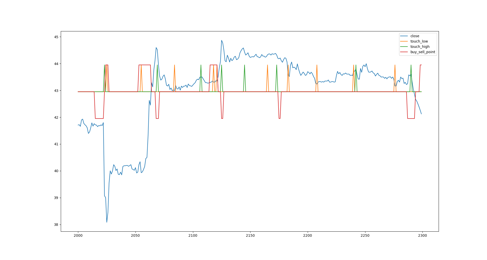

# The tutorial, step by step

The project is long and dense, _**trying to install it without understanding it is a mistake**_, the first thing to do is to run and understand the tutorial file, [`pipeline/1_train.py`](../pipeline/1_train.py)
(it was `Tutorial/RUN_buy_sell_Tutorial_3W_5min_RT.py`). It shows in a summarized way the global steps of the project
 :
1. [1] Reading OLHCV data
1. [2] Extraction of all technical patterns 
1. [3] Calculation of the grount true, the Y_target to detect in real time (where to _do nothing_, _do buy_ or _do sell_)
1. [4] Remove unhelpful or noisy technical patterns
1. [5] Normalise the data, for correct training the values must be normalised to between 0 and 1
1. [6] Create '_windows_' of time, for a Y_target prediction use +-4 hours later of technical patterns, not just the current value of the patterns 
1. [7] Splitting between training data and evaluation data 
1. [8] Ground True Y_target data are unbalanced Given that there is a lot of 'do nothing' 0, and very little 'do buy' 1 or 'do sell' 2," weight balancing is required, to give more importance to the minorities.
1. [9] Creation of the TF model architecture 
1. [10] Start the TF training and save it
1. [11] Evaluating the quality of the model 

_**Note:**_ inside the file `pipeline/1_train.py` , it is very important to understand the author's experience inside **print()** and **#TIP** comments. 

Points: _2,3,4,9,10_ and _11_ **_should be refined and improved_**.    For more details about improvements there is point [Possible improvements](improvements.md) .

##### IMPORTANT: Once executed and understood, join the community to avoid repeating work or try out useless developments already done.  
_**Telegram GROUP:**_ https://t.me/+3oG6U_hp93I2M2Ix  

### INTRODUCTION
The stock market is moved by technical indicators, there are several types of volatility, cycle volume, candlesticks, supports, resistances, moving averages...

An excellent site to see all the stock market technical indicators is webull https://app.webull.com/trade?source=seo-google-home. 

Image: webull with Stochastic, MACD and RSI indicators

On the stock market graphs have been invented EVERY possible way to predict the stock market, with mixed results, making clear the difficulty of predicting human behavior.

These indicators indicate where to buy and sell, there are many beliefs about them (we mean in beliefs, because if they always worked we would all be rich). 

Any technical indicator can be obtained by means of programmable mathematical operations.

Three examples:

**RSI** or Relative Strength Index is an oscillator that reflects relative strength

Greater than 70 overbought, indicates that it will go down.

Less than 70 oversold, indicates that it will go higher 

**MACD** is the acronym for Moving Average Convergence / Divergence. The MACD in the stock market is used to measure the robustness of the price movement. Through the crossing of the line of this indicator and the moving average

It operates on the basis of the crossovers between these two lines

Or it is operated when both exceed zero.

**Candlestick: Morning Star** The morning star pattern is considered a hopeful sign in a bearish market trend.

These indicators are present in refuted and popular websites like investing.com to be analyzed by the market <https://es.investing.com/equities/apple-computer-inc-technical>

###### How do I know when the WHALE touches the button, and breaks the model? 
In the video you can see the whales manipulating the price, does anyone think they can predict when the madman in the City of London hits the button? It is recommended to understand that there are NOT VISIBLE data, and if they are not visible TF can not do miracles (TV and politicians say that AI does miracles, what it does is massive statistics with data).  If you don't understand this I think you should go to other projects. It is recommended to avoid this code in intervals less than 1 hour. 

**See the news** _A “fat-finger error” by a [London-based trader at Citigroup that triggered a flash crash](https://www.theguardian.com/business/2022/jun/03/flash-crash-set-off-by-fat-fingered-citigroup-trader-could-cost-50m) across European stock markets could cost the bank at least $50m (£39.8m)._
**See video** [Chinese Whales Dumping Bitcoin](https://www.youtube.com/watch?v=pkgTAEsOWnA) or [alternative](https://www.youtube.com/shorts/IpIyo4YmfuY?app=desktop) .
I ask the reader at this point, **how is this predicted?** _I don't have the testosterone data of the London Kids XD ._ 😄😄

#### Self-fulfilling prophecy principle

It is extremely difficult to predict the price of any stock. Inflation, wars, populism, all this conditions affect the economy, and it becomes difficult, if not impossible to predict what Vladimir Putin will do tomorrow. 

Here enters the self-fulfilling prophecy principle of explained is, at first, a "false" definition of the situation, which awakens a new behavior that makes the original false conception of the situation become "true". Example:

#### Ground True is the variable `buy_seel_point` GT
The model to be able to train in detecting points of purchase and sale, creates the column `buy_seel_point` has value of: 0, -100, 100. These are detected according to the maximum changes, (positive 100, negative -100) in the history of the last months, this point will be with which the training is trained, also called the *ground* true. 

Defining the GT (Ground True) is a subjective task, these numbers can be obtained in 2 ways:
 - The tutorial uses `stockpred/ml/buy_sell_point.get_buy_sell_point_HT_pp` (step [3] of `pipeline/1_train.py`).
 - `Utils_buy_sell_points.get_buy_sell_points_Roll` (default of the old real-time pipeline, `legacy/realtime_v1/Utils/`). Value will be assigned in buy_seel_point if the increase or decrease of the stock is greater than 2.5% in a period of 3 hours, using the get_buy_sell_points_Roll function.

 - `Utils_buy_sell_points.get_buy_sell_points_HT_pp` (old pipeline; decomment the line) Inspired by the TraderView technical indicator "Pilots HL".
 - For change the config to **1-day candlesticks** (with frequent daily changes of +-1% defined in the variable `PER_VALEU_CHANGE = 1`). You can see it in the method `get_GT_day_candle(df_kon)` and extra `rolling_buy_sell_val_BUY(df_ind)`it is strongly recommended to use this other function to obtain the GT, [file candlesticks GT day](https://github.com/Leci37/Strategy-stock-Random-Forest-ML-sklearn-TraderView/blob/main/technical_parameters_konk_tools_Prepro.py) 

On the graphic, you can see the difference being:
**_Blue_** the candle Close
_**Red**_ the values obtained in `get_buy_sell_points_Roll()` the positive and negative peaks indicate sell and buy points.
The points obtained in `get_buy_sell_points_HT_pp()` are shown, the **_Orange_** peaks being the Buy points and the **_Green_** peaks being the Sell points.

